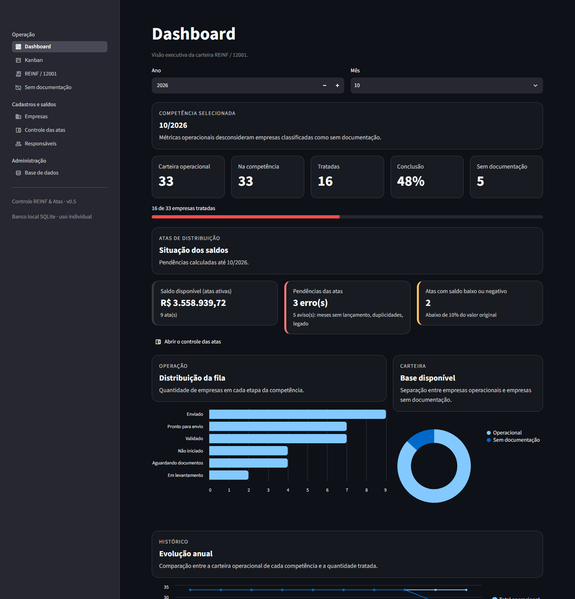
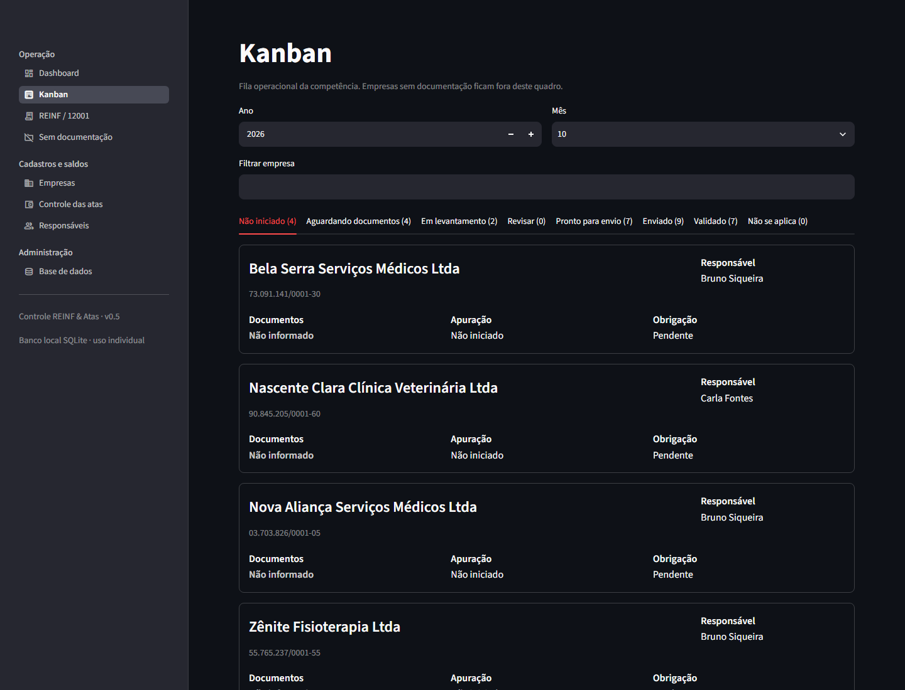
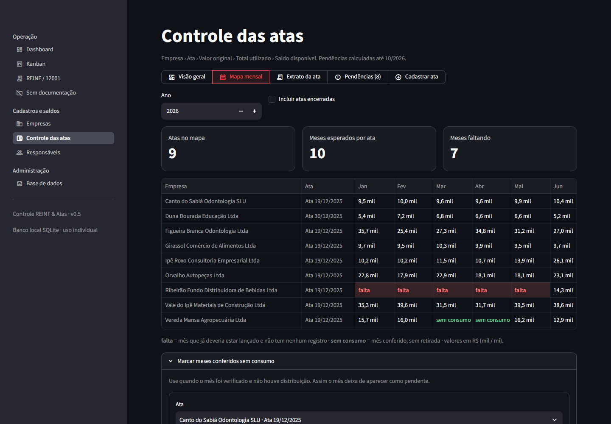
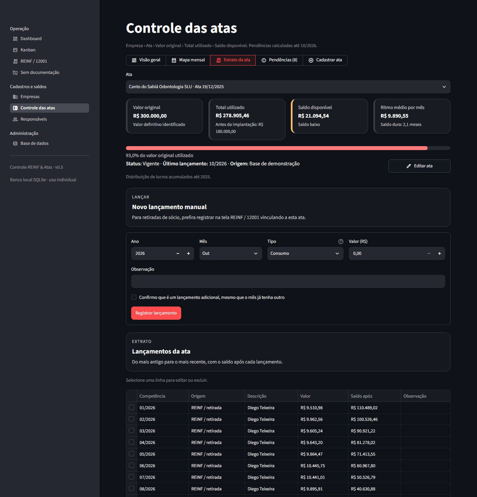
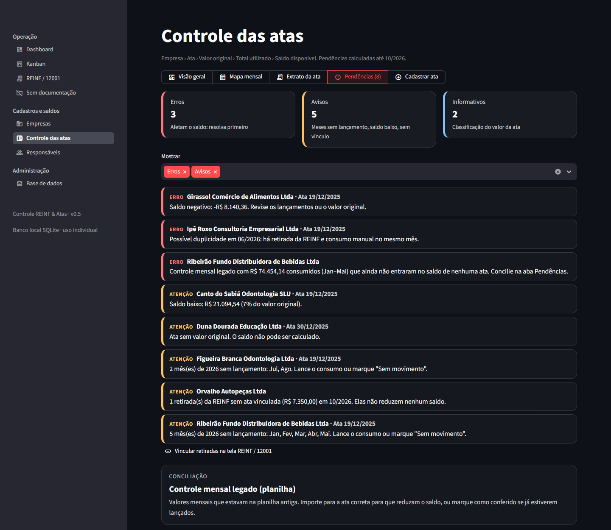

# Controle REINF & Atas

Controle de obrigações acessórias para escritório contábil, empresa por empresa: a entrega mensal da **EFD-Reinf (natureza de rendimento 12001 – lucros e dividendos)** e o **saldo das atas de distribuição de lucros** que sustentam esses pagamentos.



## O problema

Com as mudanças na tributação de dividendos a partir de 2026, ficou importante ter os lucros aprovados documentados em ata e acompanhar quanto de cada ata já foi pago aos sócios. São duas frentes ligadas: o que o sócio recebe precisa sair de uma ata com saldo e ser informado na EFD-Reinf da competência. Na prática, o escritório precisa responder todo mês, para cada cliente:

- a EFD-Reinf da competência (12001) já foi levantada, revisada e enviada?
- quanto o sócio retirou neste mês, e de qual ata esse valor sai?
- quanto ainda resta de saldo em cada ata, e por quantos meses ele dura?
- falta lançar algum mês? Algum valor foi contado duas vezes?

Antes isso ficava numa planilha com uma aba por assunto, sem histórico e com saldos digitados à mão. Este sistema substitui essa planilha.

## O que o sistema faz

- **Entrega da EFD-Reinf por competência (Dashboard e Kanban):** cada empresa passa pelas etapas *Não iniciado → Aguardando documentos → Em levantamento → Revisar → Pronto para envio → Enviado → Validado*. O Dashboard mostra o percentual de conclusão da competência; empresas sem documentação ficam numa área separada e não distorcem esse número.
- **REINF / 12001 por empresa:** status da competência e registro das retiradas dos sócios (lucros e dividendos), vinculadas a uma ata.
- **Controle das atas:** valor aprovado, total utilizado e saldo disponível por ata, com extrato cronológico e saldo após cada lançamento.
- **Mapa mensal:** uma linha por ata e uma coluna por mês, deixando à vista os meses ainda não lançados.
- **Pendências:** saldo negativo ou baixo, ata sem valor definido, meses sem lançamento, possível duplicidade (retirada da REINF e consumo manual no mesmo mês), retiradas sem ata vinculada e valores da planilha antiga ainda não conciliados.

| Kanban da entrega (EFD-Reinf 12001) | Mapa mensal das atas |
|---|---|
|  |  |
| **Extrato da ata** | **Pendências** |
|  |  |

## Decisões técnicas

- **SQLite local, sem servidor.** O sistema é usado numa única máquina; um arquivo de banco é fácil de copiar como backup.
- **Uma única fonte para o saldo.** O saldo de cada ata vem de uma view (`ata_balances` em [`database/schema.sql`](database/schema.sql)) que soma retiradas da REINF e lançamentos manuais. Todas as telas leem dessa view, então o saldo nunca diverge entre telas.
- **Histórico na mesma transação.** Inclusões, alterações e exclusões de lançamentos gravam o registro no histórico dentro da mesma transação da alteração: ou as duas coisas acontecem, ou nenhuma.
- **Valores arredondados a centavos antes de gravar,** para não acumular resíduo de ponto flutuante nos saldos.
- **Migração conservadora.** Na importação da planilha antiga, uma competência só é marcada como enviada quando o texto diz explicitamente "REINF até o mês X", e apenas de janeiro até X. Os valores mensais da planilha antiga não reduzem nenhum saldo automaticamente: ficam numa área de conciliação, e a importação é recusada se a ata já tiver lançamento naqueles meses.
- **Exclusão protegida.** Uma ata com lançamentos não pode ser excluída, só encerrada.
- **Testes automatizados** (`unittest`) para migração, leitura de xlsx, saldos, extrato, pendências, conciliação e base de demonstração.

Estrutura: `views/` (telas Streamlit), `services/` (regras e consultas), `database/` (schema e conexão), `ui/` (componentes visuais), `scripts/` (base demo e reconstrução), `tests/`.

## Limitações conhecidas

- Uso local por uma pessoa: não há login, controle de acesso nem edição simultânea.
- O sistema controla o processo de entrega, mas não gera nem transmite a EFD-Reinf.
- A importação de planilha espera um layout específico (descrito em [`services/migration.py`](services/migration.py)).

## Como rodar

Requer Python 3.12 ou superior.

```bash
python -m venv .venv
.venv\Scripts\activate        # Windows (no Linux/macOS: source .venv/bin/activate)
pip install -r requirements.txt
streamlit run app.py
```

No Windows, `setup_env.bat` prepara o ambiente e `run_app.bat` abre o app.

Na primeira execução, se `data/reinf_control.db` não existir, o app cria uma **base de demonstração com dados 100% fictícios** (40 empresas, 10 atas, competências de 2026). Nomes, sócios e CNPJs são inventados; os CNPJs têm dígito verificador válido, mas foram gerados aleatoriamente. Para recriar a base:

```bash
python scripts/seed_demo.py --reset
```

Testes:

```bash
python -m unittest discover -s tests
```

A variável de ambiente `REINF_DB_PATH` permite apontar o app para outro arquivo de banco.

## Licença

[MIT](LICENSE).

---

Desenvolvido com apoio de IA (Claude) na escrita do código. As regras de negócio, os casos de teste e a validação partiram da rotina real de um escritório contábil.
